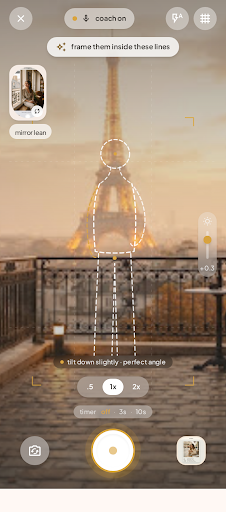

# kandid ✦

> a calm, editorial camera director that guides poses, frames angles, and curates keepers — with zero cloud image retention.

[](https://expo.dev)
[](https://reactnative.dev)
[](https://www.typescriptlang.org)
[](https://shopify.github.io/react-native-skia/)
[](./LICENSE)

---

## ✦ visual showcase

<p align="center">
  
  
  
</p>

<p align="center">
  
  
  
</p>

---

## ✦ what is kandid?

kandid turns any phone into a calm, high-fashion camera director. it eliminates the awkwardness of posing for personal photos, directs whoever is holding your phone, and automates post-shoot curation without compromising personal privacy.

### core pillars

- 📐 **parametric mannequin overlays**: responsive, normalized 15-joint vector outlines rendered at 60fps directly over your camera feed using **shopify react native skia**.
- 🎴 **safe-zone cue docking**: contextual directions separated into **subject cues** (*"rest chin on hand"*) and **photographer cues** (*"knee-height, tilted 15° up"*), docked cleanly above the shutter without obstructing the shot.
- ⏱️ **hands-free series**: hands-free countdown and recurring burst intervals (2s, 3s, 5s) for effortless solo portraits.
- ✦ **privacy-first best shots**: in-memory cloud vision ai analysis ranking expression, posture, and sharpness across bursts. **images are processed strictly in ephemeral memory buffers and discarded instantly** — zero cloud storage buckets exist.
- 🕯️ **soft light & hardware zoom**: 3-temperature screen glow tool (warm, neutral, cool) and hardware lens clamping (`0.5x`, `1x`, `2x`, `3x`) with digital zoom fallback.
- 🎨 **warm editorial glass design system**: custom typography (`playfair display` + `plus jakarta sans`) with a warm cream (`#FCF9F4`), champagne gold (`#C5A880`), sage (`#5B7E68`), and deep espresso (`#1C1A18`) palette.

---

## ✦ monorepo structure

kandid is architected as an npm monorepo with strict package boundaries:

```
kandid/
├── apps/
│   ├── mobile/            # expo sdk 58 / react native 0.88 mobile application
│   │   ├── app/           # expo router file-based routes ((tabs), camera, pose, auth)
│   │   ├── plugins/       # custom expo config plugins (gradle & cmake memory throttle)
│   │   └── src/           # components, zustand stores, and client services
│   └── web/               # store redirect & marketing site (next.js 14)
├── packages/
│   ├── ui-tokens/         # warm editorial glass design tokens (colors, radii, spacing, typography)
│   └── content/           # 60+ seed poses, 15-joint skeletons, copy dictionaries, and looks
├── supabase/
│   └── functions/         # /curate-best-shots stateless in-memory edge function
└── docs/                  # centralized architectural and technical documentation
```

---

## ✦ zero-storage privacy model

personal photos represent your most sensitive data. kandid is engineered with a **zero-image retention architecture**:

1. **100% on-device capture**: camera previews, pose guide lines, and color filters run completely offline on the device gpu.
2. **ephemeral in-memory transmission**: photos selected for curation are compressed in client ram and streamed directly over tls 1.3 into edge function memory.
3. **zero server storage**: photos are evaluated statelessly and discarded immediately from ram. no database tables or persistent cloud storage buckets exist.
4. **strict no-training guarantee**: enterprise api compliance guarantees user photos are never logged, stored, or used to train ai models.

---

## ✦ getting started

### prerequisites

- [node.js](https://nodejs.org) (v20+ or v22 LTS recommended)
- [npm](https://npmjs.com) (v10+)
- [eas cli](https://docs.expo.dev/eas/) (`npm install -g eas-cli`)
- [expo go](https://expo.dev/go) or an eas development client installed on your android device

### installation

1. clone the repository:
   ```bash
   git clone https://github.com/Geeky-ash/Kandid.git
   cd Kandid
   ```

2. install workspace dependencies:
   ```bash
   npm install --legacy-peer-deps
   ```

3. verify typecheck and design token alignment:
   ```bash
   npm run typecheck
   node packages/ui-tokens/scripts/check-token-drift.js
   ```

### running the mobile app locally

start the metro bundler with your local lan ip:

```bash
cd apps/mobile
$env:REACT_NATIVE_PACKAGER_HOSTNAME="YOUR_LOCAL_IP"
npx expo start --dev-client --host lan -c
```

open the **kandid** development build on your phone to connect to metro.

### building standalone apks via eas

trigger a cloud build via expo application services:

- **development client apk**:
  ```bash
  cd apps/mobile
  eas build --platform android --profile development
  ```

- **standalone preview apk** (zero metro server needed):
  ```bash
  cd apps/mobile
  eas build --platform android --profile preview
  ```

---

## ✦ documentation index

detailed specifications and architectural decision records are maintained in `/docs/`:

- 📋 **[PRD.md](docs/PRD.md)** — product requirements & features
- 🏛️ **[ARCHITECTURE.md](docs/ARCHITECTURE.md)** — system architecture & monorepo contracts
- 🎨 **[DESIGN.md](docs/DESIGN.md)** — design tokens, color palette, and stitch mcp alignment
- ⚖️ **[RULES.md](docs/RULES.md)** — coding standards & safe zone docking constraints
- 📜 **[DECISIONS.md](docs/DECISIONS.md)** — architectural decision records (adrs)
- 🧪 **[TESTING.md](docs/TESTING.md)** — quality assurance, hardware matrix & automated test plan
- 🧠 **[MEMORY.md](docs/MEMORY.md)** — living development progress & milestone roadmap

---

## ✦ license

distributed under the **MIT License**. see [`LICENSE`](LICENSE) for more details.
