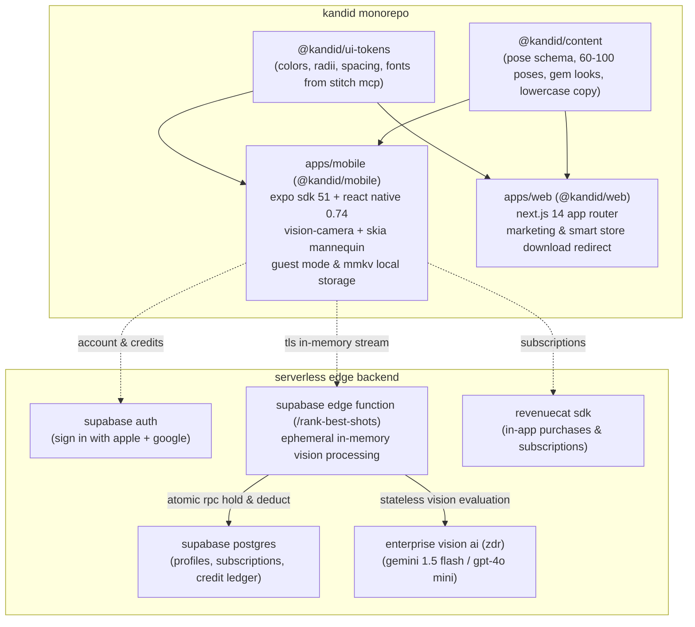
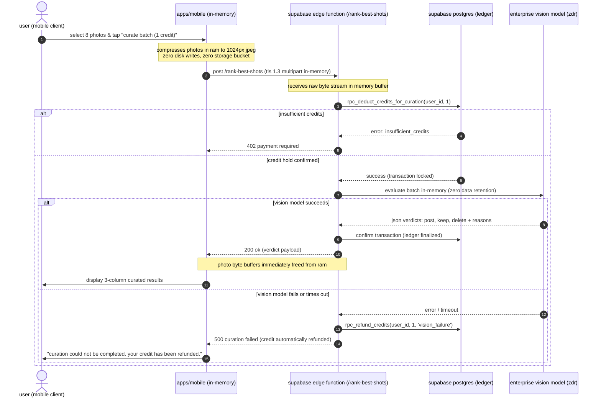

# kandid — system architecture document

> **app name**: kandid  
> **monorepo scope**: `@kandid/mobile`, `@kandid/web`, `@kandid/ui-tokens`, `@kandid/content`  
> **bundle identifier / android package**: `com.kandid.app`  
> **design theme**: `"warm editorial glass"` (stitch mcp project id: `931723337622910157`)

---

## 1. high-level monorepo architecture

kandid is architected as an npm/pnpm workspace monorepo sharing design tokens, business types, and pose content across both mobile and web clients:



### 1.1 workspace directory structure
```
kandid/
├── .agents/
│   ├── mcp_config.json          # gitignored: live stitch mcp connection
├── apps/
│   ├── mobile/                  # expo sdk 51 mobile app (@kandid/mobile)
│   │   ├── app/                 # expo router file-based routing
│   │   │   ├── (auth)/          # sign in with apple / google
│   │   │   ├── (tabs)/          # floating tab bar (home, poses, camera, best-shots, profile)
│   │   │   ├── camera/          # full-screen camera with skia guide
│   │   │   ├── guided-shoot/    # step-by-step cue card stack
│   │   │   ├── editor/          # 16 gem looks skia shader editor
│   │   │   ├── paywall/         # revenuecat pro subscription modal
│   │   │   └── _layout.tsx
│   │   └── src/
│   │       ├── components/      # atomic ui (< 150 lines per component)
│   │       ├── hooks/           # custom domain hooks
│   │       ├── services/        # camera, mmkv, supabase, revenuecat
│   │       └── stores/          # zustand stores (cameraStore, guestStore, poseStore)
│   └── web/                     # next.js 14 marketing & download site (@kandid/web)
├── packages/
│   ├── ui-tokens/               # design tokens extracted from stitch mcp (@kandid/ui-tokens)
│   │   └── src/
│   │       ├── colors.ts        # warm editorial glass palette (cream, gold, sage, espresso)
│   │       ├── typography.ts    # playfair display & plus jakarta sans scales
│   │       ├── radii.ts         # card, pill, and modal corner radii
│   │       └── spacing.ts       # margin-mobile, gutters, space steps
│   └── content/                 # domain content & pose catalog (@kandid/content)
│       └── src/
│           ├── copy.ts          # strictly lowercase copy dictionary with legal exceptions
│           ├── poses/           # 60-100 core parametric poses (joint angle coordinate data)
│           └── looks.ts         # 16 gem color matrix presets
├── docs/                        # central documentation architecture
├── .gitignore                   # ignores .agents/mcp_config.json and all secrets
├── package.json
└── tsconfig.base.json
```

---

## 2. guest mode & offline-first data model

### 2.1 guest mode operation
kandid enforces zero onboarding friction:
- **immediate utility**: camera shooting, browsing the pose library, viewing cue cards, and applying gem looks operate 100% offline without requiring an account.
- **local state storage**: guest favorites, recent shoots metadata, and user preferences are persisted locally using `react-native-mmkv` (fast encrypted key-value storage).
- **account barrier**: an account is prompted and required **only** when the user accesses:
  1. best shots cloud ai curation (requires credit ledger).
  2. purchasing consumable credit packs.
  3. subscribing to kandid pro via revenuecat.
- **sign-in options**: supports sign in with apple (mandatory on ios) and google sign-in. when a guest signs in, their local mmkv favorites and shoot history seamlessly merge into their remote supabase profile.

---

## 3. parametric skia mannequin architecture

instead of bundling 350+ heavy static svg images or png illustrations that inflate binary size and fail to scale across different camera aspect ratios (4:3, 16:9, 1:1), kandid stores poses as **normalized joint-angle coordinates** rendered in real-time by a single `@shopify/react-native-skia` component.

### 3.1 pose schema with dual cues
```typescript
export interface JointCoordinate {
  id: 'nose' | 'left_shoulder' | 'right_shoulder' | 'left_elbow' | 'right_elbow'
    | 'left_wrist' | 'right_wrist' | 'left_hip' | 'right_hip'
    | 'left_knee' | 'right_knee' | 'left_ankle' | 'right_ankle';
  x: number; // normalized coordinate 0.0 to 1.0 relative to viewfinder width
  y: number; // normalized coordinate 0.0 to 1.0 relative to viewfinder height
  confidence?: number;
}

export interface Pose {
  id: string;                    // e.g. "seated_editorial_01"
  category: 'solo' | 'duo' | 'seated' | 'standing' | 'mirror' | 'golden_hour';
  difficulty: 'easy' | 'moderate' | 'expert';
  aspect_ratio: '4:3' | '16:9' | 'all';
  is_pro: boolean;               // true if unlocked via pro subscription
  skeleton_joints: JointCoordinate[];
  framing_guides: {
    recommended_lens: '1x' | '2x' | '0.5x';
    camera_angle: 'waist_level' | 'eye_level' | 'low_angle';
    rule_of_thirds_line: 'left_vertical' | 'right_vertical' | 'center';
  };
  // dual cues: separated for the poser vs the phone holder
  subjectCues: string[];         // e.g. ["rest left elbow on knee", "chin tilted slightly down"]
  photographerCues: string[];   // e.g. ["lower phone to chest height", "align subject eyes with upper grid line"]
}
```

### 3.2 rendering pipeline & catalog scale
1. **skia rendering component (`MannequinOverlay.tsx`)**:
   - receives the `skeleton_joints` array for the active pose.
   - projects normalized coordinates `(x, y)` to device viewfinder dimensions.
   - draws smooth connecting bones using skia paths with a gentle champagne gold / white stroke (`strokeWidth: 2.5`, `color: 'rgba(252, 249, 244, 0.65)'`, dashed joints).
   - updates at a sustained 60fps with zero garbage collection overhead.
2. **bundle efficiency**:
   - launch catalog consists of **60–100 core poses**.
   - entire 100-pose json payload is **< 45 kb**, compared to > 25 mb for equivalent static raster/vector graphics.
3. **remote delta sync**:
   - new seasonal collections are published as versioned json deltas via supabase storage cdn.
   - the app checks for new pose deltas on wifi, downloading and caching them locally in mmkv/sqlite without requiring app store updates.

---

## 4. camera controls & hardware lens clamping

kandid interacts directly with device camera hardware via `react-native-vision-camera`:

### 4.1 hardware lens discovery & strict clamping
- **query physical devices**: upon camera mounting, the camera service queries `Camera.getAvailableCameraDevices()`.
- **hardware zoom pills**:
  - devices with native optical lenses (e.g. iphone 15 pro: ultra-wide 13mm, wide 24mm, telephoto 77mm / 120mm) dynamically display physical lens pills: `[0.5x, 1x, 2x, 5x]`.
  - tapping a pill switches to the corresponding physical camera device directly, preserving full optical sensor resolution.
  - digital zoom is clamped strictly to hardware bounds to prevent image degradation.
- **android single-lens fallback**:
  - budget or mid-tier android devices exposing only a single camera stream fall back smoothly to digital zoom intervals: `[1x, 2x]`.
  - smooth pinch-to-zoom gestures map smoothly across `[1.0, 4.0]` using `useSharedValue` from `react-native-reanimated`.

### 4.2 android blur fallback
- on ios, control bars and cue cards render with `expo-blur`.
- on android (especially budget devices running api 26–30), real-time backdrop blur can drop frame rates below 30fps.
- **fallback implementation**: `Platform.OS === 'android'` automatically switches to solid translucent styling (`#1c1a18e6` for dark cards, `#fcf9f4f2` for light huds) with zero blur computation.

---

## 5. best shots curation & privacy architecture

best shots is kandid's sole cloud ai feature, designed with an uncompromising privacy architecture:



### 5.1 in-memory zero-storage guarantee
- **no supabase storage bucket**: no s3/supabase buckets exist in the architecture for user photos.
- **ephemeral buffers**: photos are streamed as byte arrays directly into edge function memory, parsed into base64 thumbnails, sent to the vision model over tls, and garbage collected immediately upon response completion.
- **enterprise privacy agreement**: the vision ai provider (gemini enterprise or gpt-4o mini enterprise) operates under a formal enterprise business agreement with:
  1. zero data retention (zdr): images are discarded immediately after inference.
  2. strict no-training guarantee: user images are never used to train or fine-tune models.
  3. us/eu data residency compliance.

### 5.2 server-side atomic credit ledger
credits are tracked in a secure postgres ledger table with row-level security (rls):
```sql
create table public.credit_ledger (
  id uuid primary key default gen_random_uuid(),
  user_id uuid references auth.users(id) on delete cascade not null,
  amount integer not null, -- positive for purchase, negative for curation
  balance_after integer not null,
  transaction_type text check (transaction_type in ('initial_grant', 'purchase', 'curation_hold', 'curation_deduct', 'curation_refund')),
  reference_id text,
  created_at timestamptz default now() not null
);
```
- clients cannot write directly to the credit table.
- deductions and refunds are executed exclusively through postgres stored procedures (`rpc_deduct_credits_for_curation`, `rpc_refund_credits`) with strict row locking (`select ... for update`).

---

## 6. security & configuration rules

### 6.1 repository secret hygiene
- `.agents/mcp_config.json` is strictly ignored in `.gitignore`.
- never commit live stitch api keys, supabase service role keys, or revenuecat secret keys.
- client builds bundle only public anonymous keys (`EXPO_PUBLIC_SUPABASE_ANON_KEY`, `EXPO_PUBLIC_REVENUECAT_APPLE_KEY`).

### 6.2 app store & google play privacy compliance
- **app store privacy nutrition labels**:
  - *photos*: collected solely for app functionality (`user-selected only`, ephemeral processing, not linked to user identity, not tracked).
  - *sign in with apple*: implemented alongside google sign-in on ios.
- **google play data safety**:
  - *photos*: ephemeral processing disclosed; encrypted in transit over https/tls; zero cloud persistence.
