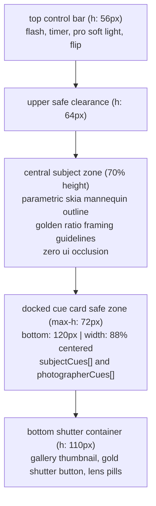

# kandid — design system & ui specification

> **visual source of truth**: connected stitch mcp project (`project id: 931723337622910157`) and downloaded exports in `/design/stitch/`.  
> **design system theme**: `"warm editorial glass"`  
> **primary backgrounds**: `#fcf9f4` (cream canvas) and `#f0ede9` (nested section container)  
> **palette accents**: `#c5a880` (champagne gold), `#5b7e68` (sage mist), and `#1c1a18` (rich espresso)  
> **typography**: `Playfair Display` (editorial headlines) and `Plus Jakarta Sans` (ui & body copy)  
> **copy rule**: all user-facing copy is strictly lowercase (exceptions: legal text, user names, error codes, and platform trademarks).

---

## 1. design philosophy & brand identity

kandid’s visual identity balances high-fashion editorial warmth with tactile clarity:
- **warm editorial glass**: replaces clinical dark modes and sterile whites with tactile cream canvases (`#fcf9f4`), warm card sections (`#f0ede9`), frosted glass panels, and deep espresso typography (`#1c1a18`).
- **tactile reassurance**: generous card radii (24–32px), pill-shaped controls (9999px), subtle border lines (`#e5e2dd`), and spring physics make the app feel warm and personal.
- **zero camera anxiety**: soothing lowercase guidance, unobtrusive docked cue cards, and gentle gold/sage accents create a calm, supportive shooting environment.
- **quiet clarity**: no intrusive audio or voice interruptions while shooting; all guidance is delivered cleanly through visual overlays and docked on-screen cue cards.

---

## 2. design tokens & accessibility contrast

### 2.0 stitch mcp source of truth & synchronization rules
- **sole source of truth**: the live stitch project (`id: 931723337622910157`) via stitch mcp is the authoritative definition for all design tokens: colors, fonts, line heights, radii, and spacing scales.
- **generation pipeline**: `packages/ui-tokens` must be generated directly from the stitch project token definitions and exports. manual, unverified token inventions are strictly forbidden.
- **same-commit synchronization rule**: any change, adjustment, or calibration made to any design token in `packages/ui-tokens` **strictly requires updating `docs/DESIGN.md` in the exact same git commit**. out-of-sync tokens or docs will fail pre-commit and ci validation.
- **milestone drift check**: before any milestone is marked done, an explicit token drift check must be executed, comparing the tokens in code to the live stitch project via mcp.

### 2.1 color palette (warm editorial glass)

```typescript
export const colors = {
  // background canvas & surfaces (from stitch mcp)
  background: {
    primary: '#fcf9f4',        // warm editorial cream canvas (surface / surface-bright)
    secondary: '#f0ede9',      // warm section container (surface-container)
    surface: '#ffffff',        // pure white cards (surface-container-lowest)
    surfaceMuted: '#faf7f2',   // muted warm card tint (surface-container-low)
    overlay: 'rgba(28, 26, 24, 0.45)', // camera backdrop scrim
    hud: 'rgba(252, 249, 244, 0.88)',  // frosted glassmorphic hud (ios)
    hudFallback: '#fcf9f4f2',  // solid translucent fallback for android
    cueCard: 'rgba(28, 26, 24, 0.82)', // dark translucent docked cue card
    cueCardFallback: '#1c1a18e6', // solid translucent dark fallback for android
  },

  // typography & content (calibrated for wcag aa)
  text: {
    primary: '#1c1a18',        // deep dark espresso (14.8:1 contrast on cream)
    secondary: '#6b635a',      // warm mid-gray body (4.9:1 contrast on cream, meets wcag aa)
    tertiary: '#8a8178',       // restricted strictly to non-essential elements (timestamps, decorative dots)
    inverse: '#ffffff',        // crisp white text on dark badges / dark overlays
    onGold: '#1c1a18',         // espresso text strictly required on gold fills (never white on gold)
  },

  // accents & brand tones (from stitch mcp)
  brand: {
    gold: '#c5a880',           // champagne gold (primary container fill)
    goldDark: '#725b38',       // deep champagne gold for active borders
    sage: '#5b7e68',           // sage mist (positive feedback, gentle guide)
    sageDark: '#4a7046',       // darkened sage for white-text badges (5.0:1 contrast)
    sageTint: '#e8f0eb',       // sage tint container for dark espresso text
    espresso: '#1c1a18',       // rich dark espresso
  },

  // borders & dividers
  border: {
    subtle: '#cac6bd',         // outline-variant from stitch
    medium: '#e5e2dd',         // surface-variant
    focus: '#c5a880',          // active gold focus ring
  },

  // curation verdicts (best shots badges)
  status: {
    post: '#4a7046',           // darkened sage for white text badge (5.0:1 contrast)
    postContainer: '#e8f0eb',  // light sage tint container (paired with #1c1a18 text, 5.2:1)
    keep: '#c5a880',           // champagne gold fill container (paired with #1c1a18 text, 5.5:1)
    keepContainer: '#fedeb2',  // light gold tint container
    delete: '#b8433b',         // darkened crimson for white text badge (4.9:1 contrast)
    deleteContainer: '#fdf2f0',// light blush container (paired with #93000a text, 5.8:1)
  },
} as const;
```

---

### 2.2 wcag aa contrast compliance table

all text pairings strictly observe a **minimum 4.5:1 contrast ratio** for standard text and **minimum 3.0:1 for large text (18px+ bold or 24px+ regular)**. minimum ui text size is enforced at **12px**.

| foreground (text) | background (surface) | computed ratio | wcag level | usage rule & notes |
| :--- | :--- | :--- | :--- | :--- |
| `text.primary` (`#1c1a18`) | `bg.primary` (`#fcf9f4`) | **14.8:1** | **aaa** | primary headlines, titles, active labels |
| `text.primary` (`#1c1a18`) | `bg.secondary` (`#f0ede9`) | **13.5:1** | **aaa** | section titles, container labels |
| `text.primary` (`#1c1a18`) | `brand.gold` (`#c5a880`) | **5.5:1** | **aa (passes 12px+)** | **mandatory**: espresso text on gold buttons (never white on gold) |
| `text.secondary` (`#6b635a`) | `bg.primary` (`#fcf9f4`) | **4.9:1** | **aa** | body paragraphs, subtitle hints, secondary metadata |
| `text.secondary` (`#6b635a`) | `bg.secondary` (`#f0ede9`) | **4.5:1** | **aa** | nested section captions, secondary list items |
| `text.inverse` (`#ffffff`) | `status.post` (`#4a7046`) | **5.0:1** | **aa** | solid green "post" badge in best shots |
| `text.inverse` (`#ffffff`) | `status.delete` (`#b8433b`) | **4.9:1** | **aa** | solid crimson "delete" badge in best shots |
| `text.inverse` (`#ffffff`) | `bg.cueCard` (`#1c1a18e6`) | **15.2:1** | **aaa** | white cue text inside dark docked cue card |
| `text.primary` (`#1c1a18`) | `status.postContainer` (`#e8f0eb`) | **12.8:1** | **aaa** | tinted "post" card container with espresso text |
| `text.primary` (`#1c1a18`) | `brand.sage` (`#5b7e68`) | **5.1:1** | **aa** | espresso text on filled sage mist container |
| `text.tertiary` (`#8a8178`) | `bg.primary` (`#fcf9f4`) | **3.4:1** | *non-essential* | **strictly restricted** to non-essential elements: inactive pagination dots, decorative hairline dividers |

> [!CAUTION]
> **gold contrast rule**: white text on champagne gold (`#c5a880`) yields an inaccessible ratio of **2.2:1 (fails wcag aa)**. gold button containers must **always and exclusively** use dark espresso text (`#1c1a18`) or dark brown (`#281800`). thin gold icons or gold body text on cream canvases are strictly prohibited.

---

## 3. typography & font hierarchy

kandid uses two complementary typefaces:
- **editorial display / headlines**: `Playfair Display` (serif, romantic, editorial, thoughtful).
- **interface / body**: `Plus Jakarta Sans` (sans-serif, geometric, highly legible at small sizes).
- **minimum text size**: **12px** across all mobile screens.

```typescript
export const typography = {
  fontFamilies: {
    headline: 'Playfair Display',
    body: 'Plus Jakarta Sans',
  },

  fontSize: {
    displayLg: 36,     // playfair display regular, leading 42
    headlineLg: 28,    // playfair display medium, leading 34
    headlineMd: 22,    // playfair display medium, leading 28
    headlineSm: 18,    // playfair display semibold, leading 24
    bodyLg: 16,        // plus jakarta sans regular, leading 24
    bodyMd: 14,        // plus jakarta sans regular, leading 20
    bodySm: 12,        // plus jakarta sans regular, leading 16 (system floor)
    labelLg: 14,       // plus jakarta sans semibold, leading 18
    labelMd: 12,       // plus jakarta sans semibold, leading 16
    labelSm: 12,       // plus jakarta sans bold, leading 14 (uppercase/caps banned, lowercase only)
  },
} as const;
```

---

## 4. layout, safe zones & cue card docking

### 4.1 the docked cue card safe zone
in earlier designs, cue cards were placed beside the viewfinder, occluding the subject's posture and causing cognitive overload. in kandid, cue cards are docked in a strictly defined safe zone:



- **anchor point**: anchored at `bottom: 120px` (directly above the lens selector and shutter container).
- **maximum dimensions**: width 88% of screen (max-width 380px), maximum height 72px.
- **clearance guarantee**: the central 70% of the camera viewport remains completely clear, ensuring that the subject outline, eyes, hands, and framing lines are never occluded.
- **dual cue layout**: cards display a small pill indicator (`"for you"` vs. `"for subject"`), the lowercase prompt (`"lean shoulder against frame"`), and a subtle advance arrow with a haptic tick on swipe.

### 4.2 android blur fallback
on ios, floating chrome and hud elements utilize `expo-blur` with `systemUltraThinMaterialLight`. on android, hardware blur can introduce jank or dropped frames during camera preview:
- **fallback specification**: on android devices, blur views automatically fall back to solid translucent colors:
  - dark camera chrome: `#1c1a18e6` (90% opacity espresso).
  - floating pill tab bar: `#fcf9f4f2` (95% opacity cream) with a 1px border (`#e5e2dd`).

---

## 5. component library & token styling

### 5.1 pill button (`PillButton.tsx`)
- **radii**: `9999px` (pill).
- **variants**:
  - `primary` (gold): background `#c5a880`, text `#1c1a18`, subtle shadow `rgba(197, 168, 128, 0.25)`.
  - `secondary` (cream): background `#ffffff`, text `#1c1a18`, border `1px solid #cac6bd`.
  - `ghost`: transparent background, text `#1c1a18`, active highlight `#f0ede9`.
- **minimum touch target**: `48px` height, `48px` width.

### 5.2 floating pill tab bar (`TabBar.tsx`)
- docked at bottom with `env(safe-area-inset-bottom) + 16px`.
- height `64px`, radius `32px`, centered max-width `380px`.
- elevated gold circular shutter button (`58px` diameter) in center with gold shadow.
- 4 navigation tabs: `home`, `poses`, `best shots`, `profile`.

---

## 6. screen-by-screen stitch design mapping (actual files in `/design/stitch/`)

all mobile screens correspond directly to the exported screens downloaded in `/design/stitch/`:

| screen # | screen name | actual stitch export file | stitch title | core ui elements & layout |
| :--- | :--- | :--- | :--- | :--- |
| **01** | onboarding / welcome | [`/design/stitch/7a54ced9b4554dccb83f79d3307f6b1d.png`](file:///e:/Photogenik/design/stitch/7a54ced9b4554dccb83f79d3307f6b1d.png) | `photogenik - welcome` | tilted photo collage, tagline `"effortless angles for every shot."`, social proof placeholders (`[stat_users_coached]`), gold `"get started"` pill button, `"continue as guest"` link. |
| **02** | home / mode selector | [`/design/stitch/bdc50b0dc7bd41168d8369148c764967.png`](file:///e:/Photogenik/design/stitch/bdc50b0dc7bd41168d8369148c764967.png) | `photogenik - choose your camera` | header `"pick a pose, we'll guide the shot"`, dual mode cards (*pose camera* vs. *hands-free series*), quick actions carousel (*soft light*, *pose me*), recent shoot summary. |
| **03** | pose library | [`/design/stitch/24054a865ee845d688fdb4508cdf6829.png`](file:///e:/Photogenik/design/stitch/24054a865ee845d688fdb4508cdf6829.png) | `photogenik - pose library` | search bar, horizontal scrolling filter chips (`all`, `solo`, `couple`, `seated`, `standing`, `golden hour`), 2-column grid of poses with favorite hearts. count derived at build/runtime. |
| **04** | pose detail | [`/design/stitch/2b109ecf9e884ac99855fded578c44b6.png`](file:///e:/Photogenik/design/stitch/2b109ecf9e884ac99855fded578c44b6.png) | `photogenik - pose detail` | parametric mannequin hero card, dual cues list (`subjectCues` + `photographerCues`), sticky bottom bar with `"save to shoot"` and `"use this pose"`. |
| **05** | camera with visual guide | [`/design/stitch/3f4f2f3828c04cc2b119ce9cbfd6039b.png`](file:///e:/Photogenik/design/stitch/3f4f2f3828c04cc2b119ce9cbfd6039b.png) | `photogenik - camera with visual guide` | full-screen viewfinder, semi-transparent parametric mannequin outline, framing guidelines, docked swipeable cue card zone above shutter, gold shutter button, timer, zoom, flip. |
| **06** | guided shoot | [`/design/stitch/cae0aad2e07f4ec581c7bb39167b12f7.png`](file:///e:/Photogenik/design/stitch/cae0aad2e07f4ec581c7bb39167b12f7.png) | `photogenik - live coaching` | full-screen stack of cue cards with progress indicator (`"cue 2 of 4"`), `"next cue"` advance button with haptic tick, hands-free series timer cadence controls. |
| **07** | best shots curation | [`/design/stitch/5094ba4cbb73451dba7b6c8d3562b1a1.png`](file:///e:/Photogenik/design/stitch/5094ba4cbb73451dba7b6c8d3562b1a1.png) | `photogenik - best shots` | batch picker (up to 10 photos per credit), 3-column sorted cards (`post`, `keep`, `delete`), lowercase reason callout on each photo, credits indicator, bottom sheet with `"edit this one"`. |
| **08** | looks editor | [`/design/stitch/184f6b2f7e3c4757afb0c621df4e1c4a.png`](file:///e:/Photogenik/design/stitch/184f6b2f7e3c4757afb0c621df4e1c4a.png) | `photogenik - editor looks` | 16 gem-named looks horizontal carousel (*citrine*, *sapphire*, etc.), hold-to-compare overlay, intensity slider (0–100%), `"export to photos"` pill button. |
| **09** | paywall & subscription | [`/design/stitch/b012bff62e534cb8920a5aa4f7e376be.png`](file:///e:/Photogenik/design/stitch/b012bff62e534cb8920a5aa4f7e376be.png) | `photogenik - paywall` | annual/monthly toggle (highlighting 7-day free trial on annual), feature list, gold `"start 7-day trial"` button, `"restore purchases"`, legal links. |
| **10** | profile & settings | [`/design/stitch/0c41e1c556c8476794286f47bb792bab.png`](file:///e:/Photogenik/design/stitch/0c41e1c556c8476794286f47bb792bab.png) | `photogenik - profile` | shoots count, saved poses grid, ai permissions toggle (best shots ai), sign in with apple / google, language selector, terms, privacy policy, sign out, `"delete account"`. |
| **logo**| vector brand mark | [`/design/stitch/b52f48681af2436ab91425fdaad854ca.png`](file:///e:/Photogenik/design/stitch/b52f48681af2436ab91425fdaad854ca.png) | `Photogenik Logo` | brand logo asset in svg and high-resolution render. |

---

## 7. stitch export deviations & adaptations

to strictly implement kandid's text-guided, offline-first scope while preserving stitch visual elegance:

| screen # | stitch export reference | visual deviation in stitch export | rationale & replacement component in kandid |
| :--- | :--- | :--- | :--- |
| **screen 02** | `bdc50b0dc7bd41168d8369148c764967.png` | shows legacy "native vs. coaching camera" cards. | **updated layout**: header changed to `"pick a pose, we'll guide the shot"`. two cards now represent (a) `"pose camera"` (overlay + framing guides + docked cue cards) and (b) `"hands-free series"` (interval timer burst). quick actions remain `"soft light"` and `"pose me"`. |
| **screen 04** | `2b109ecf9e884ac99855fded578c44b6.png` | shows audio voice test button. | **updated layout**: audio button removed. replaced with structured list of ordered lowercase cue cards split into `subjectCues` ("rest hand on chin") and `photographerCues` ("drop phone to waist height"). |
| **screen 05** | `3f4f2f3828c04cc2b119ce9cbfd6039b.png` | shows microphone toggle icon. | **updated layout**: microphone icon removed. replaced with docked on-screen swipeable `CueCard` in safe zone above the shutter container, leaving the center 70% unobstructed. |
| **screen 06** | `cae0aad2e07f4ec581c7bb39167b12f7.png` | shows audio waveform and voice listening chip. | **updated layout**: renamed to **guided shoot**. audio waveform removed. replaced with a visual stack of cue cards, step progress indicator (`"cue 2 of 4"`), `"next cue"` advance button with haptics, and interval timer controls. |
