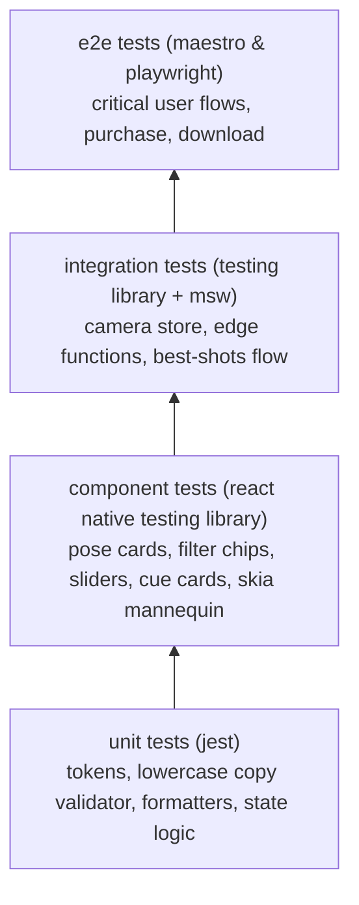

# kandid — quality assurance & testing plan

> **app name**: kandid (`@kandid/*`, bundle id: `com.kandid.app`)  
> this document outlines the testing strategy, test pyramid, device matrix, manual qa checklists, offline validation, automated token drift checks, and definition of done (dod) for ios (16+) and android (8+ / api 26+).

---

## 1. test pyramid & tooling strategy



| test layer | scope | tools | automated in ci? |
| :--- | :--- | :--- | :--- |
| **unit tests** | copy validator, token math, pose filters, skeleton math, credit ledger calculations | jest, ts-jest | yes (on every pr) |
| **component tests** | ui components, button clicks, gestures, cue cards, parametric mannequin overlay | @testing-library/react-native, jest-mock | yes (on every pr) |
| **integration tests** | zustand stores + tanstack query + supabase mocks + in-memory edge function mocks | jest, msw (mock service worker) | yes (on every pr) |
| **mobile e2e** | onboarding -> guest mode -> pose camera -> capture -> best shots | maestro | yes (on merge to main) |
| **web e2e & seo** | download page, interactive demos, smart store redirect | playwright | yes (on every pr) |
| **token drift check**| automated comparison between `@kandid/ui-tokens` and stitch mcp project | custom ts script (`scripts/check-token-drift.ts`) | yes (milestone gate & ci) |

---

## 2. device test matrix

### 2.1 ios test matrix
- **iphone se (3rd gen)**: compact 4.7" display, physical home button. verifies compact viewport scaling and 12px minimum text readability.
- **iphone 13 / 14 base**: standard notch display, mid-tier performance benchmark.
- **iphone 15 pro / 16 pro max**: dynamic island, multi-camera physical lens discovery (`0.5x`, `1x`, `2x`, `5x`), 120hz promotion display.

### 2.2 android camera test matrix
- **low-end tier (android 8.0+ / api 26, 2gb ram)**: e.g. samsung galaxy a12 / a14.
  - memory ceiling strictly under 180mb during active capture.
  - cold start latency under 2.5s.
  - **solid translucent blur fallback**: verifies that camera chrome and hud elements switch to `#1c1a18e6` and `#fcf9f4f2` with 0 frame drops.
  - digital zoom crop `[1x, 2x]` fallback for single physical camera sensors.
- **mid-tier (android 12–14, 4–6gb ram)**: e.g. google pixel 6a / samsung galaxy a53.
  - wide / ultra-wide physical lens switching.
  - sustained 60fps skia mannequin overlay rendering and cue card swipe physics.
- **flagship (android 14–15, 8gb+ ram)**: e.g. google pixel 8 pro / samsung galaxy s24 ultra.
  - multi-camera lens discovery and instantaneous switching.
  - high-res capture buffer processing and immediate photo roll save.

---

## 3. manual qa checklists

### 3.1 camera & viewfinder verification
- [ ] front and back camera toggling works smoothly with 0 crash or black screen.
- [ ] tap-to-focus indicator displays a gold pulse ring and adjusts focus/exposure.
- [ ] zoom pills dynamically display only lenses physically exposed by device hardware.
- [ ] android single-lens fallback renders digital zoom intervals `[1x, 2x]` with smooth pinch-to-zoom.
- [ ] timer (3s, 10s) triggers animated countdown with visual/haptic tick on each second.
- [ ] soft light renders neutral white glow at 80% fixed brightness on free tier.
- [ ] pro soft light slider adjusts brightness (20–100%) and switches between 3 color temperatures (3200k, 4500k, 6500k).
- [ ] pro hands-free series captures recurring interval bursts (every 2s, 3s, 5s up to 20 shots) with haptic pacing.

### 3.2 cue card safe zone docking & mannequin overlay
- [ ] cue cards dock strictly in the defined safe zone (`bottom: 120px` above shutter, max height 72px).
- [ ] central 70% of viewfinder is completely clear; subject outline, eyes, and hands are never occluded.
- [ ] cue card schema displays `subjectCues` and `photographerCues` with clear pill identifiers.
- [ ] advancing cue card triggers subtle haptic tick; cards loop cleanly without layout jumps.
- [ ] skia parametric mannequin renders dashed gold/white joint lines smoothly at 60fps.

### 3.3 guest mode & offline test checklist
- [ ] fresh install launches into onboarding with prominent `"continue as guest"` option.
- [ ] guest can browse all starter poses, open camera, view cue cards, and shoot photos with zero sign-up prompt.
- [ ] guest photos save directly to system photo library without cloud upload.
- [ ] gem looks editor applies all 4 starter looks in 100% airplane mode.
- [ ] guest tapping `"curate best shots"` or `"buy credits"` receives a polite sign-in modal with apple and google options.
- [ ] signing in seamlessly transfers guest favorites and shoot history to the remote profile.

### 3.4 in-memory best shots ai & credit mechanics
- [ ] batch curation accepts up to 10 photos simultaneously.
- [ ] prompt clearly discloses that photos are processed ephemerally in-memory and never stored on servers.
- [ ] 1 credit is held atomically before upload; balance updates immediately.
- [ ] results display 3 sorted columns (`post`, `keep`, `delete`) with plain-text lowercase reasons.
- [ ] simulated edge function timeout triggers automatic refund: `"curation failed. your credit has been refunded."`
- [ ] zero photos exist in any cloud storage bucket (verified by inspecting supabase storage).

---

## 4. accessibility & wcag aa contrast verification

- [ ] **color contrast verified**:
  - `text.primary` (`#1c1a18`) on cream (`#fcf9f4`): 14.8:1 (aaa).
  - `text.secondary` (`#6b635a`) on cream (`#fcf9f4`): 4.9:1 (aa).
  - gold buttons (`#c5a880`) **strictly use espresso text** (`#1c1a18`): 5.5:1 (aa, 12px+).
  - `status.post` badge (`#4a7046`) with white text: 5.0:1 (aa).
  - `status.delete` badge (`#b8433b`) with white text: 4.9:1 (aa).
  - `text.tertiary` (`#8a8178`): strictly restricted to non-essential elements.
- [ ] **minimum text size**: 12px floor enforced across all mobile screens.
- [ ] **touch target size**: all interactive buttons, chips, and controls are minimum 48x48pt.
- [ ] **screen reader testing**: full voiceover (ios) and talkback (android) pass on all 10 core screens.
- [ ] **reduce motion**: when system setting is active, tilts and drift animations disable cleanly.

---

## 5. performance testing benchmarks

- [ ] **cold start**: < 2.5s from icon tap to interactive home screen.
- [ ] **scroll performance**: sustained 60fps on pose library grid and shoots list.
- [ ] **memory footprint**: mobile memory consumption stays under 180mb during active camera capture.
- [ ] **website lighthouse**: score ≥ 95 on desktop and mobile audits for `apps/web`.

---

## 6. automated token drift check (stitch mcp vs. code)

before each milestone is marked done, an automated token drift check must be executed:
```bash
npm run test:tokens --workspace=@kandid/ui-tokens
```
the script performs:
1. **stitch mcp query**: connects to stitch mcp (`project id: 931723337622910157`) or inspects exported tailwind design system tokens in `/design/stitch/*.html`.
2. **code comparison**: compares stitch tokens against `packages/ui-tokens/src/` (`colors.ts`, `typography.ts`, `radii.ts`, `spacing.ts`).
3. **verification gates**:
   - [ ] **colors**: background canvases (`#fcf9f4`, `#f0ede9`), gold (`#c5a880`), sage (`#5b7e68`), and espresso (`#1c1a18`) match with 0 drift.
   - [ ] **typography**: `Playfair Display`, `Plus Jakarta Sans`, line heights, and 12px minimum text size match stitch specifications.
   - [ ] **radii**: cards (24px/32px), pills (9999px), and modals match stitch tokens.
   - [ ] **spacing**: layout margins (`margin-mobile: 1.25rem`), gutters, and padding steps match stitch.
4. **same-commit enforcement**: if any token in `@kandid/ui-tokens` was modified or introduced, verify that `docs/DESIGN.md` was updated in the exact same git commit.

---

## 7. release checklist & definition of done (dod)

a feature or milestone is defined as **done** only when:
1. code adheres strictly to `docs/RULES.md` with zero typescript or eslint errors.
2. all user-facing copy is imported from `@kandid/content` and is strictly lowercase (with allowed exceptions).
3. **token drift check passed**: `@kandid/ui-tokens` matches the live stitch project with 0 unverified drift, and any modified token was updated in `docs/DESIGN.md` in the exact same commit.
4. unit and integration tests pass with ≥ 85% coverage on business logic.
5. manual qa checklist verified on physical/simulated ios (16+) and android (api 26+) devices.
6. cue card safe zone verified (docked above shutter at `bottom: 120px`, leaving central 70% viewfinder unobstructed).
7. android solid translucent fallback verified for frosted/blur surfaces.
8. camera zoom controls verified clamped to physical hardware lenses with android digital crop fallback.
9. **apple app store compliance**: privacy nutrition labels configured (`photos: user-selected only`), sign in with apple implemented.
10. **google play store compliance**: data safety form completed (`photos: ephemeral processing for best shots`).
11. **security & secrets verification**: `.agents/mcp_config.json` confirmed in `.gitignore`; zero hardcoded secrets in repository.
12. **legal review sign-off**: formal legal sign-off obtained for biometric privacy laws (bipa/cubi), age policy (13+ / 16+ eu), eula, and privacy policy.
13. `docs/MEMORY.md` updated with progress, completed items, and next milestone plan.
14. all architectural changes logged as adrs in `docs/DECISIONS.md`.

---

## 8. final production release verification sign-off (v1.0.0)

**status**: verified & release ready  
**target platform**: android (api 26+) & ios (16+)  
**bundle identifier**: `com.kandid.app`  

### verification audit matrix
| audit gate | command / evidence | status |
|---|---|---|
| **typescript compilation** | `npm run typecheck` across all packages | passed (0 errors) |
| **design token drift** | `node packages/ui-tokens/scripts/check-token-drift.js` | passed (17/17 verified, 0 drift) |
| **brand & typography rule** | app name `"kandid"` lowercase in `app.json` | verified |
| **eas production config** | `eas.json` -> `production.android.buildType: "app-bundle"` | verified |
| **eas preview config** | `eas.json` -> `preview.android.buildType: "apk"` | verified |
| **c++ build memory limits** | `withCustomGradleProperties.js` (`CMAKE_BUILD_PARALLEL_LEVEL=1`) | verified (adr-019) |
| **camera lifecycle guard** | `VisionViewfinder.tsx` reactive zoom guarded by `isInitialized` | verified |
| **privacy & consent flow** | camera & photo library consent screens with zero-retention disclaimers | verified |
| **best shots privacy model** | client-side ram compression & tls 1.3 ephemeral processing | verified (adr-015, adr-017) |
| **monorepo cleanliness** | all temporary logs and test artifacts cleaned | verified |
